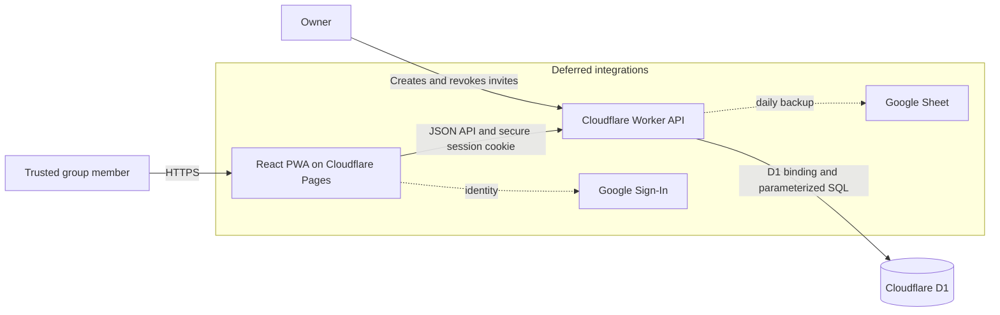
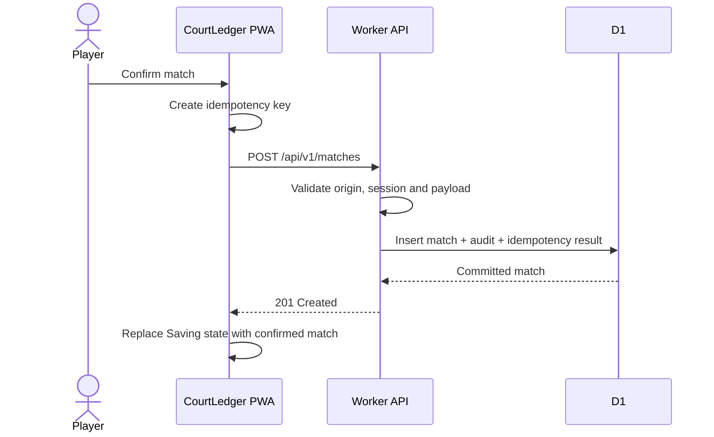
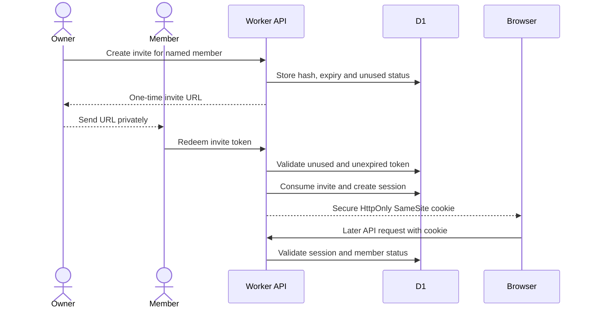
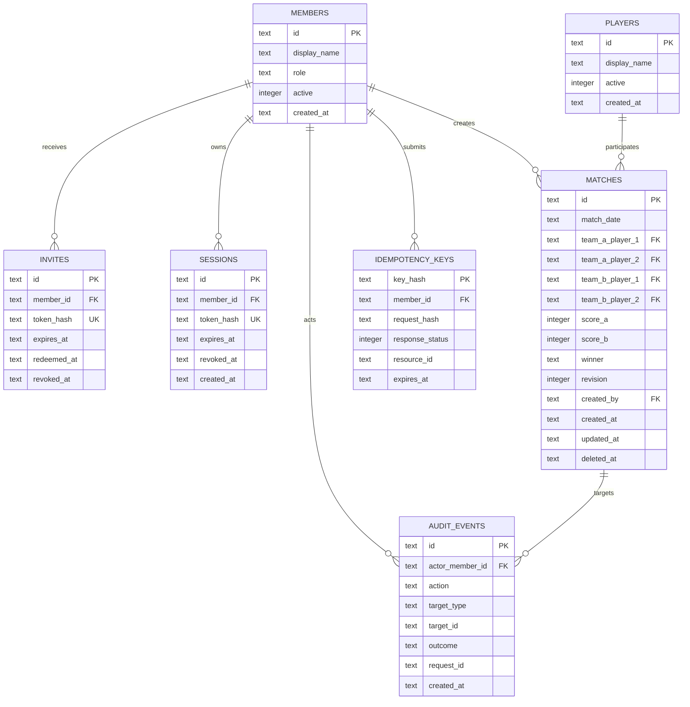
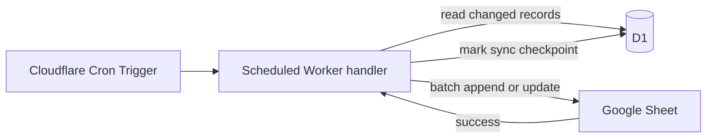

# CourtLedger shared backend architecture

Status: approved direction, implementation not started  
Current phase: Cloudflare Worker API and D1 only  
Deferred: Google Sheets backup, Google Sign-In, multi-group tenancy

## Purpose

CourtLedger currently stores matches in each browser's IndexedDB. That is useful for a personal, offline-first app, but it cannot provide one shared ledger to a group using different phones.

This phase introduces a central API and database while preserving the existing React PWA. Cloudflare D1 becomes the canonical shared data source. IndexedDB remains a device cache and must not independently decide the authoritative state of a match.

## System context



## Deployment topology

Frontend and backend code live in the same Git repository but deploy as separate Cloudflare services.

```text
CourtLedger repository
├── src/                    React PWA
├── public/                 manifest, service worker, icons
├── worker/                 planned Worker API
│   ├── src/
│   ├── migrations/
│   └── wrangler.jsonc
└── docs/

Cloudflare Pages            frontend deployment
Cloudflare Worker           API deployment
Cloudflare D1               shared relational storage
```

Production and preview resources must be isolated:

| Environment | Frontend | API | Database | Secrets |
| --- | --- | --- | --- | --- |
| Local | Vite | Wrangler local runtime | Local D1 | `.dev.vars`, Git-ignored |
| Preview | Pages preview | Staging Worker | Staging D1 | Staging secrets only |
| Production | Pages `main` deployment | Production Worker | Production D1 | Production secrets only |

A feature preview must never receive production database or production secret bindings.

## Request architecture



The UI may display a temporary `Saving` state, but it must not show an unconfirmed write as permanently saved. The server response is authoritative.

## Authentication model for this phase

This phase uses owner-issued invitations rather than Google login.



Security properties:

- Invite tokens use at least 256 bits of cryptographically secure randomness.
- D1 stores a one-way hash of invite and session tokens, not their raw values.
- Invites are single-use and expire after a short period.
- Sessions are represented by opaque cookies with `HttpOnly`, `Secure`, and `SameSite=Lax` attributes.
- Sessions expire and can be revoked individually or per member.
- Losing browser data or changing devices requires a new invitation in this phase.
- Invitation authentication is suitable for a small trusted group, but it does not prove a real-world identity as strongly as Google Sign-In.

## Authorization roles

Initial roles:

| Role | Capabilities |
| --- | --- |
| Owner | Manage invites and members; revoke sessions; read audit history; create and edit matches |
| Scorer | Read shared data; create and edit matches |

Future roles may include administrator and read-only viewer. Authorization is enforced by the Worker, never only by hiding UI controls.

## Planned API surface

All endpoints are versioned under `/api/v1`.

| Method | Route | Purpose | Authentication |
| --- | --- | --- | --- |
| `GET` | `/health` | Minimal service health | Public, no internals |
| `POST` | `/invites/redeem` | Redeem a one-time invitation | Invite token and rate limit |
| `POST` | `/sessions/logout` | Revoke the current session | Member session |
| `GET` | `/session` | Return current member/session summary | Member session |
| `GET` | `/matches` | Read active matches, paginated or date-filtered | Member session |
| `POST` | `/matches` | Create a match | Scorer or owner |
| `PATCH` | `/matches/:id` | Edit a match with revision check | Scorer or owner |
| `DELETE` | `/matches/:id` | Soft-delete a match | Scorer or owner |
| `GET` | `/members` | List group members | Member session |
| `POST` | `/admin/invites` | Create an invitation | Owner |
| `POST` | `/admin/sessions/:id/revoke` | Revoke a session | Owner |
| `GET` | `/admin/audit` | Read important mutations and security events | Owner |

The browser is never allowed to send arbitrary SQL, choose a table, or call D1 directly.

## D1 data model



`members` are authenticated people allowed to operate the app. `players` are people who can appear in matches. They are deliberately separate: a scorer need not be one of the four players, and deactivating an account must not damage match history. Existing player identifiers remain stable so historical matches are not coupled to editable display names.

## Correctness controls

### Idempotency

The client supplies an idempotency key for every mutating request. The Worker stores a hash of the key, a hash of the request, and the prior result. Repeating the same request returns the original result; reusing the key for a different request is rejected.

### Optimistic concurrency

Every match has an integer `revision`. An edit includes the revision last read by the client. The update succeeds only when that revision still matches, then increments it. A stale edit receives `409 Conflict` instead of overwriting a newer change.

### Deletion

Match deletion is initially a soft delete using `deleted_at`. This supports auditability and recovery. Destructive purging is not exposed as an ordinary API operation.

### Transactions

Related D1 statements use bound parameters and `D1Database.batch()` when atomic behavior is required, such as creating a match together with its audit and idempotency records.

## Validation

The Worker repeats all important domain validation even when the UI already validates:

- exactly four distinct known, active players;
- valid match date;
- supported winning targets of 21, 15, 11, or 7;
- score range and win conditions consistent with CourtLedger rules;
- no tied completed score;
- bounded string and request body sizes;
- known properties only, rejecting unexpected input where appropriate.

Client-side validation remains for immediate feedback. Server-side validation is the security and integrity boundary.

## Abuse controls

Initial conservative limits:

| Operation | Suggested limit |
| --- | --- |
| Invite redemption | 5 attempts per IP per 15 minutes |
| Match mutations | 10 per member per minute |
| General authenticated API | 60 requests per member per minute |
| Request body | Small explicit limit, for example 16 KB |

Rate limits reduce abuse but do not replace authentication or validation. Turnstile can be added to invite redemption if real abuse appears; it is not required for each match entry.

## Secrets

No production secret belongs in Git, client JavaScript, Pages environment output, IndexedDB, logs, or screenshots.

This phase may require a session-token pepper or signing secret. It is stored as a Cloudflare Worker Secret and accessed only through the Worker's runtime binding. Local development uses a Git-ignored `.dev.vars` file. Preview and production use different values.

Google service-account credentials are explicitly deferred and will be added only with the Google Sheets backup phase.

## Logging and audit

Worker logs are short-lived diagnostics containing request ID, route, outcome, latency, and safe error code. They must exclude raw invite tokens, cookies, authorization values, and secrets.

D1 `audit_events` is the durable application audit trail for:

- invitation creation, redemption, revocation, and failure;
- session revocation;
- match creation, editing, and soft deletion;
- authorization failures worth investigating.

Routine successful reads are not permanently audited.

## Failure behavior

Protected endpoints fail closed:

- session cannot be verified: reject with `401`;
- member lacks permission: reject with `403`;
- stale match revision: reject with `409`;
- rate limit exceeded: reject with `429`;
- database unavailable or transaction uncertain: return a safe `5xx` and do not report success;
- malformed input: reject with `400` or `422`.

Every response includes a request ID that can be correlated with safe Worker logs.

## Offline behavior

IndexedDB becomes a cache of server-confirmed matches. The first backend iteration will prioritize correct online shared writes. A later offline-write queue may be added, but it requires explicit conflict, replay, and duplicate handling and must not be implied merely because the app is installable as a PWA.

## Cost envelope

The expected private-group workload is far below the current Cloudflare Workers and D1 free allowances. Cost safety still requires authentication, rate limits, indexed queries, pagination, payload limits, and usage monitoring. Free-tier limits are provider policy and must be rechecked before each significant expansion.

## Deferred Google Sheets backup

The planned next phase will keep D1 authoritative and run one scheduled Worker job daily:



Stable match IDs, not row numbers, will identify Sheet records. Failed backup attempts will remain retryable and will not affect live UI reads or writes.

## Delivery sequence

1. Add Worker workspace, Wrangler configuration, environment separation, and local scripts.
2. Add D1 migrations and typed database access.
3. Implement validation, error envelopes, request IDs, and security headers.
4. Implement invite redemption, session cookies, revocation, and owner authorization.
5. Implement match read/create/edit/soft-delete endpoints with idempotency and revisions.
6. Add API unit and integration tests against local D1.
7. Introduce a frontend API/storage adapter while retaining IndexedDB as a cache.
8. Create staging Worker/D1 resources and test through the feature preview.
9. Create production resources only after preview verification and PR review.
10. Add the deferred daily Google Sheets backup in a later feature branch.

## Non-goals for this branch

- Google Sheets or Google Drive integration;
- Google login/OAuth;
- multiple independent badminton groups;
- public user registration;
- billing or paid services;
- using the Sheet as the live transactional database.
